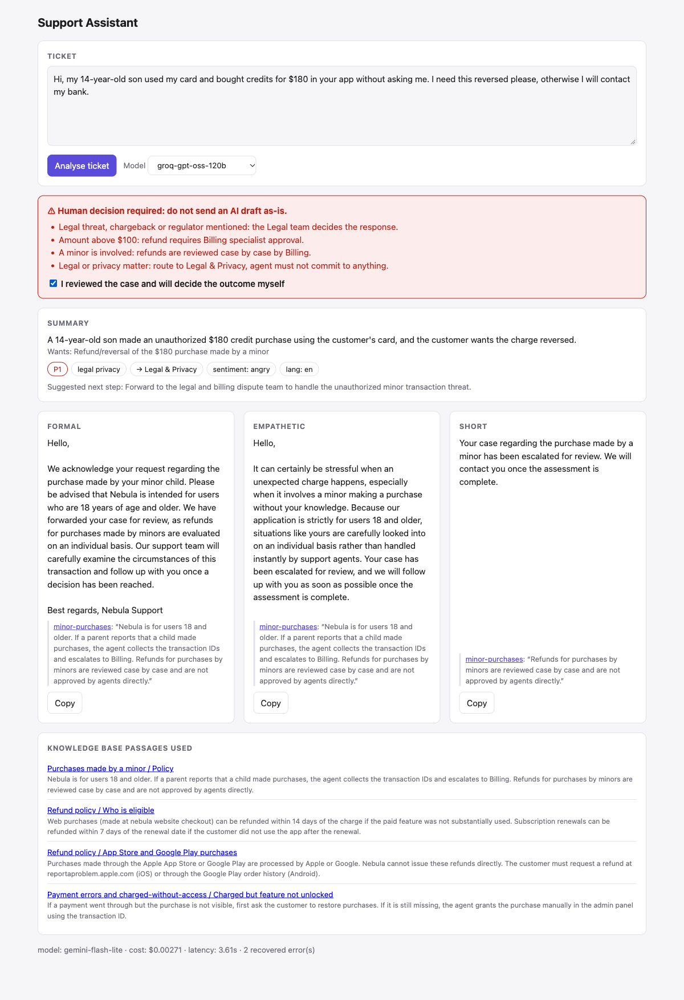

# Nebula support AI: ticket classifier + agent assistant

OBRIO AI Ops test task.

| | What it does | Report |
|---|---|---|
| **Task 1** | Ticket → category, priority (P1–P4), recommended next step, routing team, `needs_human` | [`docs/task1_report.md`](docs/task1_report.md) |
| **Task 2** | Ticket → summary, 3 reply drafts (formal / empathetic / short) in the customer's language, verified KB citations, human-review gate | [`docs/task2_report.md`](docs/task2_report.md) |

Answers to the brief, one folder per task: [`task1/answers.md`](task1/answers.md) and [`task1/hint.md`](task1/hint.md) (grading criteria); [`task2/answers.md`](task2/answers.md) and [`task2/hint.md`](task2/hint.md).

Design decisions with alternatives and reasons: [`docs/design_decisions.md`](docs/design_decisions.md).

## Results

| | Result |
|---|---|
| Classifier, final (gpt-oss-120b + prompt v3 + rules) | **95.2%** fully correct (category and priority) on 42 tuning tickets, **93.3%** on 15 held-out tickets; 100% of human-needed tickets flagged; ~$0.0004 per ticket (~$4 per 10k) |
| Prompt evolution v1 → v3 | Pass rate 50% → 95% (gpt-oss-120b), 62% → 95% (Gemini Flash-Lite), 33% → 90% (gpt-oss-20b) |
| Assistant, final (Gemini Flash-Lite + draft_v4) | 100% real citations, 100% correct language, 100% distinct tones, 0 invented numbers, 0 internal-rule leaks, 0 "already done" claims, 100% correct human flags on 14 tickets; ~$0.003 per ticket |
| Tests | 57 unit tests, no network (`pytest`) |



## Quick start

```bash
uv sync                       # creates .venv with all dependencies
source .venv/bin/activate
cp .env.example .env          # add GEMINI_API_KEY and GROQ_API_KEY (both have free tiers)

pytest -q                                          # unit tests, no network
uvicorn app.main:app                               # Task 2: http://localhost:8000  ·  Task 1: http://localhost:8000/classify

python -m eval.run_classifier_eval --models groq-gpt-oss-120b --prompts v3                     # classifier eval
python -m eval.run_classifier_eval --models groq-gpt-oss-120b --prompts v3 --dataset holdout   # held-out set
python -m eval.run_assist_eval --model gemini-flash-lite --sleep 8                             # assistant eval
```

API: `POST /api/classify` and `POST /api/assist` with `{"text": "...", "model": null}`; `GET /kb/{article_id}`.

Free tiers have per-minute and per-day limits (Groq gpt-oss-120b: 8k tokens/min, 200k tokens/day). Use `--sleep` for evals. When a limit is hit, the app fails over to the next model automatically.

> **Demo only:** the API has no authentication or rate limiting and spends your API credits. Put it behind SSO or an API-key header before anyone else can reach it.

## Architecture

```
ticket ─┬─> classifier (Task 1): prompt v3 → LLM (JSON) → validation → rules (escalate only)
        │                         → category / priority / next step / team / needs_human
        │
        └─> assistant (Task 2): analyze (summary, language, English query, candidate articles)
                 → BM25 over KB sections (+ boost for model-picked articles)
                 → draft 3 tones + citations (one call)
                 → checks: quotes exist · numbers grounded · no internal rules · right language
                 → UI: banner + locked copy buttons when a human must decide
```

| Layer | Files | Notes |
|---|---|---|
| Provider adapter | `core/llm.py` | Gemini and Groq through their OpenAI-compatible APIs. Timeout, retry with backoff (honours `Retry-After`), no retry on daily quotas, cost accounting incl. cached tokens |
| Structured output | `core/json_guard.py` | Parse, validate (Pydantic), one repair retry, next model in the chain, then a safe default |
| Cache | `core/cache.py` | SQLite, thread-safe. Key = prompt content hash + model (+ KB hash); stores the raw model answer, rules re-applied on every hit |
| Classifier | `classifier/` | `schema.py` (taxonomy, routing), `prompts/v1–v3.md`, `rules.py`, `classify.py` |
| Assistant | `assistant/` | `kb/*.md` (18 articles), `retrieval.py`, `assist.py`, `prompts/analyze_v1.md`, `draft_v1–v4.md` |
| Web | `app/` | FastAPI; `/classify` = Task 1 classifier page, `/` = Task 2 agent assistant |
| Eval | `eval/`, `data/`, `results/` | Labelled sets (`tickets_eval.jsonl`, `tickets_holdout.jsonl`, `assist_eval.jsonl`); every run saved as `.md`, `.csv` and `.json` |

Models, prices and fallback order: `config/models.yaml`. The classifier chain is gpt-oss-120b → Gemini 3.5 Flash-Lite → gpt-oss-20b; the assistant chain is Gemini 3.5 Flash-Lite → gpt-oss-120b → gpt-oss-20b. Each task uses the model that measured best for it, with a different provider as backup.
